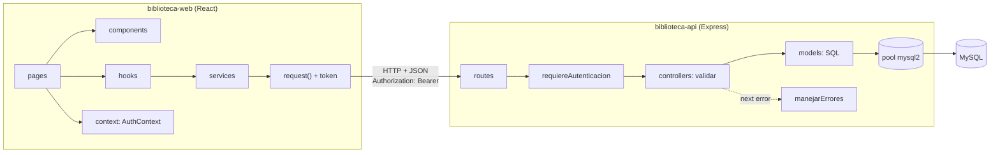
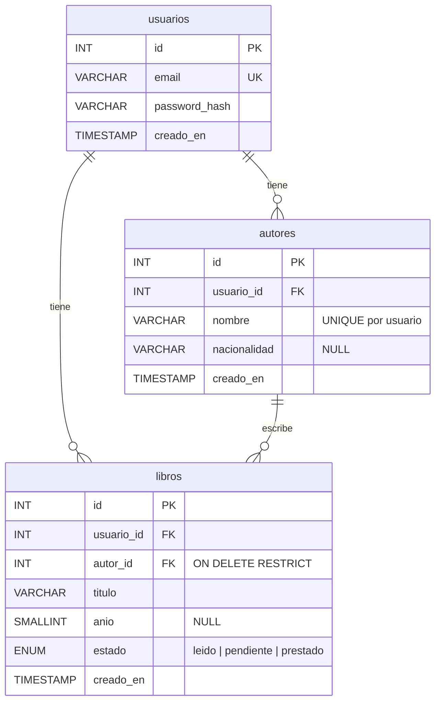

# Biblioteca personal: resumen del proyecto

Trabajo final de **Programación IV**. Aplicación web full-stack con API REST en capas, autenticación con JWT y cliente React.

## 1. Qué hace

| Funcionalidad | Detalle |
|---|---|
| Cuentas de usuario | Registro e inicio de sesión con email y contraseña (hash con bcrypt, sesión con JWT de 2 h) |
| Autores | Alta, listado (con cantidad de libros), edición y baja. No se puede borrar un autor que tiene libros |
| Libros | Alta, listado, edición y baja. Cada libro tiene título, autor, año (opcional) y estado |
| Estados | **Leído**, **Pendiente** o **Prestado**; se cambian desde la lista con un clic |
| Búsqueda y filtros | Por título (mientras se escribe), por estado y por autor |
| Resumen | Al entrar: total de libros y cuántos hay en cada estado |
| Privacidad | Cada usuario ve y modifica **solo** sus autores y libros |

## 2. Tecnologías

| Capa | Tecnología | Versión | Uso |
|---|---|---|---|
| Base de datos | MySQL / MariaDB | 8 / 10.4+ | Persistencia |
| Backend | Node.js | 22 LTS | Entorno de ejecución (ES Modules) |
| | Express | 5 | Servidor HTTP y rutas |
| | mysql2 | 3 | Conexión a MySQL con pool y consultas parametrizadas |
| | bcrypt | 6 | Hash de contraseñas |
| | jsonwebtoken | 9 | Firma y verificación de tokens JWT |
| | cors | 2 | Permitir pedidos solo desde el cliente |
| | dotenv | 18 | Variables de entorno |
| Frontend | React | 19 | Interfaz |
| | Vite | 8 | Servidor de desarrollo y build |
| | React Router | 7 | Navegación y rutas protegidas |
| | oxlint | 1 | Análisis estático (lint) |

## 3. Arquitectura

- **API en capas:** las *routes* definen los endpoints; el middleware verifica el JWT y deja `req.usuario`; los *controllers* validan la entrada y eligen el código HTTP; los *models* ejecutan SQL. Los errores llegan a un único `manejarErrores`.
- **Cliente en capas:** los *services* son el único lugar que conoce URLs; los *hooks* (`useLibros`, `useAutores`) manejan estado, carga y error; las *pages* y *components* solo dibujan.
- **React nunca habla con MySQL:** todo pasa por la API.

## 4. Modelo de datos

- **autores 1 : N libros.** `libros.autor_id` es FK con `ON DELETE RESTRICT`: la base impide borrar un autor que tiene libros.
- **usuarios 1 : N autores / libros.** Con `ON DELETE CASCADE`: si se borra un usuario, se borran sus datos.
- `estado` es un `ENUM`: la base rechaza cualquier otro valor (segunda barrera además de la validación de la API).

## 5. API REST

Base: `http://localhost:3000/api` · Formato: JSON · Errores: `{ "error": "mensaje" }`
🔒 = requiere `Authorization: Bearer <token>`.

### Autenticación

| Método | Ruta | Cuerpo | Respuestas |
|---|---|---|---|
| POST | `/auth/registro` | `{ email, password }` | **201** `{ token, usuario }` · 400 datos inválidos · 409 email ya registrado |
| POST | `/auth/login` | `{ email, password }` | **200** `{ token, usuario }` · 401 email o contraseña incorrectos |

### Autores 🔒

| Método | Ruta | Cuerpo | Respuestas |
|---|---|---|---|
| GET | `/autores` | — | **200** lista con `cantidad_libros` |
| GET | `/autores/:id` | — | **200** · 400 id inválido · 404 |
| POST | `/autores` | `{ nombre, nacionalidad? }` | **201** · 400 · 409 nombre repetido |
| PUT | `/autores/:id` | `{ nombre, nacionalidad? }` | **200** · 400 · 404 · 409 |
| DELETE | `/autores/:id` | — | **204** · 404 · 409 tiene libros |

### Libros 🔒

| Método | Ruta | Cuerpo | Respuestas |
|---|---|---|---|
| GET | `/libros?estado=&buscar=&autor_id=` | — | **200** lista con `autor_nombre` · 400 filtro inválido |
| GET | `/libros/:id` | — | **200** · 400 · 404 |
| POST | `/libros` | `{ titulo, autor_id, anio?, estado? }` | **201** fila completa · 400 (incluye autor inexistente o ajeno) |
| PUT | `/libros/:id` | `{ titulo, autor_id, anio?, estado? }` | **200** fila completa · 400 · 404 |
| PATCH | `/libros/:id/estado` | `{ estado }` | **200** · 400 · 404 |
| DELETE | `/libros/:id` | — | **204** · 404 |

**Validaciones:** título obligatorio (≤ 200); año entero entre 0 y el año actual, o vacío; estado ∈ {leido, pendiente, prestado}; el autor debe existir y ser del usuario; nombre de autor obligatorio (≤ 150); email con formato válido; contraseña ≥ 6 caracteres. Los textos se recortan (`trim`): un título con solo espacios es inválido.

**Códigos usados:** 200 OK · 201 Created · 204 No Content · 400 Bad Request · 401 Unauthorized · 404 Not Found · 409 Conflict · 500 Internal Server Error.

## 6. Rutas del cliente

| Ruta | Pantalla | Acceso |
|---|---|---|
| `/` | Inicio (resumen por estado si hay sesión) | Pública |
| `/login` | Ingresar | Pública |
| `/registro` | Crear cuenta | Pública |
| `/libros` | Lista con filtros, cambio de estado y borrado | 🔒 Protegida |
| `/libros/nuevo` | Alta de libro | 🔒 Protegida |
| `/libros/:id` | Edición de libro | 🔒 Protegida |
| `/autores` | Alta, edición y baja de autores | 🔒 Protegida |
| `*` | Página no encontrada | Pública |

Las rutas protegidas usan `RutaProtegida`: sin sesión redirigen a `/login` y, al ingresar, vuelven a la página pedida.

## 7. Seguridad

| Medida | Cómo |
|---|---|
| Contraseñas | Nunca se guardan: solo un hash **bcrypt** (costo 10) |
| Sesión | **JWT** firmado con `JWT_SECRET` (en `.env`), vence a las 2 h |
| Aislamiento entre usuarios | Todas las consultas filtran por `usuario_id` del token; un recurso ajeno responde **404** (no 403) para no revelar que existe |
| Login | Mismo 401 si el email no existe o la contraseña está mal: no revela qué emails están registrados |
| Inyección SQL | Todas las consultas usan placeholders `?` |
| Base de datos | La app usa un usuario MySQL con permisos mínimos (sin `DROP`, `ALTER`, etc.) |
| CORS | Solo se aceptan pedidos desde `FRONTEND_URL` |
| Errores | Los 500 responden un mensaje genérico; el detalle solo se ve en la consola del servidor |
| Token vencido en el cliente | Ante un 401, el cliente borra la sesión y vuelve a `/login` |

## 8. Cumplimiento de la consigna

| Requisito mínimo | Cómo se cumple |
|---|---|
| Al menos dos tablas relacionadas en MySQL, con su `schema.sql` | `autores` 1:N `libros` (+ `usuarios`) · `biblioteca-api/database/schema.sql` |
| API en capas (rutas, controladores, modelos), con validaciones y códigos HTTP correctos | `src/routes`, `src/controllers`, `src/models` · validación por campo · 8 códigos HTTP |
| Autenticación con JWT; cada usuario ve y modifica solo sus datos | `auth.controller.js` + `requiereAutenticacion.js` · `usuario_id = ?` en todas las consultas |
| React: 4 rutas mínimo (1 protegida) | 8 rutas, 4 protegidas |
| CRUD completo de al menos una entidad | Libros (y también autores) |
| Formulario con validación | `FormularioLibro`, `FormularioAutor`, `Registro` |
| Estados de carga y error | En todas las listas, el detalle y los botones de envío |
| Un hook propio | `useLibros`, `useAutores` |
| Un Context para la sesión | `AuthContext` + `useAuth` |
| Repositorio con README (instalar, variables de entorno, crear la base) | [README.md](README.md) |

## 9. Decisiones de diseño

- **Borrado físico con 409** en lugar de borrado lógico: la FK protege la integridad y no hace falta filtrar "borrados" en cada consulta.
- **404 para recursos ajenos** en lugar de 403: evita que se puedan descubrir ids de otros usuarios.
- **Token en `localStorage`:** simple para este alcance. En producción conviene una cookie `httpOnly`.
- **Validación en los dos lados:** el cliente valida para dar respuesta inmediata; la API valida siempre, porque es la única defensa real.
